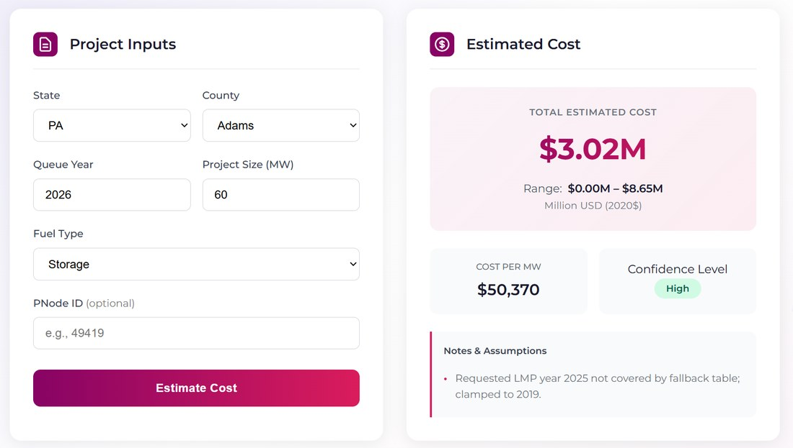

# Interconnection Cost Estimator

A web form that estimates what it costs to connect a new energy project to the U.S. grid, backed by a machine learning model served from a FastAPI service.

Built during my interconnection research internship at LaReg Corp (with Berkeley Lab data).

*An example run: project details in, an estimate, a range, cost per MW, and a confidence level out.*

## The problem

Interconnection queues run into delays and cost overruns, and the records that explain them are spread across grid operators (ISOs) in different formats. This project standardizes that data and uses it to give a first-pass cost estimate for a proposed project.

## What it does

You enter:

- state
- county
- queue year
- project size (MW)
- fuel type
- an optional PNode ID

It returns:

- an estimated total cost
- a lower and upper range
- cost per MW
- a confidence indicator based on how much data supports the result
- a notes panel listing the assumptions behind the result, for example when the requested year falls outside the lookup data

Costs are reported in 2020 dollars.

## How it works

**Data.** I standardized 5,462 interconnection projects from multiple ISOs into one dataset covering queue records, costs, locations, and market signals.

**Model.** I engineered cost and temporal features and trained PyTorch models. I compared them with linear regression and tree-based models (random forest, gradient boosting, extra trees). Costs are heavily right-skewed, so I log-transformed the target. Linear regression handled the non-linear relationships poorly, and the tree-based models were more stable.

**Backend.** A FastAPI service on AWS EC2. The web form sends five inputs. The backend builds the rest of the model's features from historical lookups and falls back to state-level values when county data is missing. The service code is in `interconnection_api.zip`.

**Frontend.** Plain HTML, CSS, and JavaScript (`index.html`, `styles.css`, `app.js`).

## Results and limits

I checked the model on held-out data and on a separate 20-project validation set. One documented evaluation reached a test R² (log) of 0.377 and an MAE (log) of 0.704.

What that means in practice:

- Costs in this data are heavily skewed, and accuracy dropped most on the highest-cost projects. I isolated and documented those cases.
- The estimate is a starting point, not a quote. Use the range and confidence label, not the single number.
- Results depend on historical data. For years or counties outside it, the service falls back to broader values and says so in the notes.

## Tools

Python, PyTorch, scikit-learn, FastAPI, AWS EC2, HTML, CSS, JavaScript
